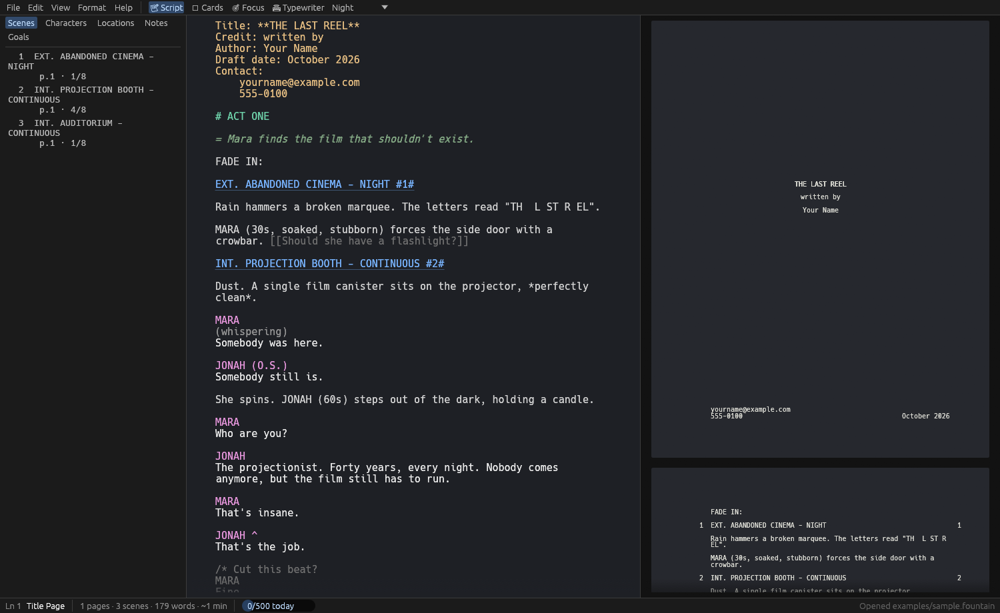
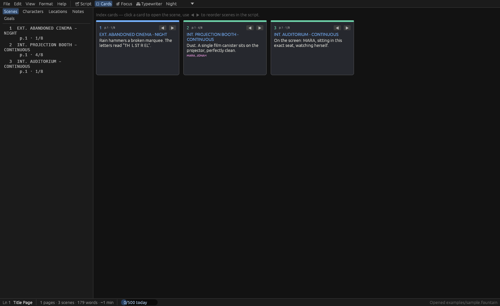
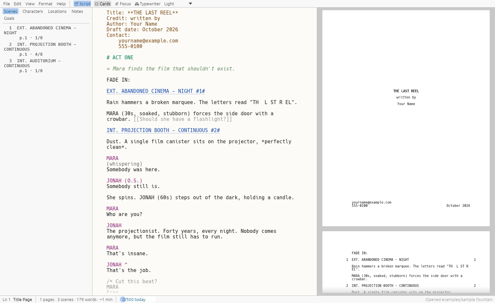
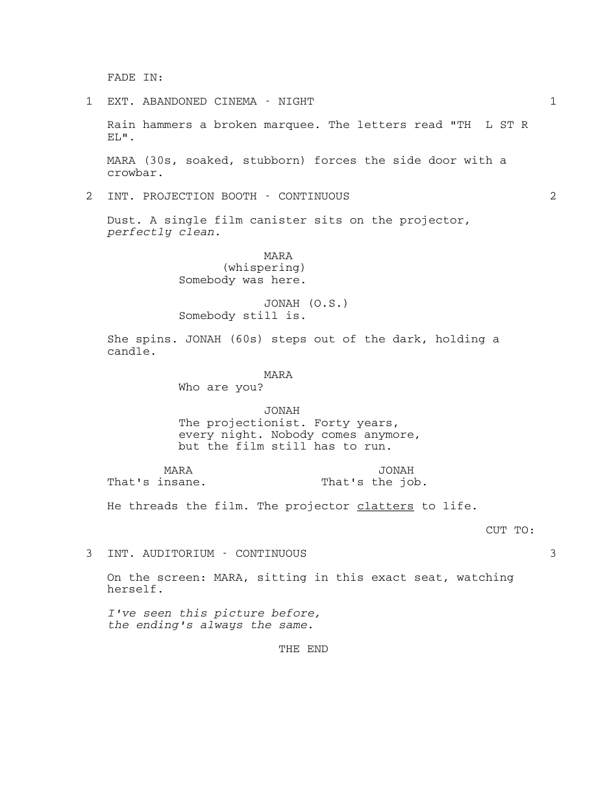

# ReelScript

A screenplay toolkit written in Rust. Write in plain-text [Fountain](https://fountain.io), get a
correctly paginated, industry-standard screenplay PDF — or round-trip to Final Draft `.fdx`.

ReelScript ships as three pieces:

| Crate | What it is |
|---|---|
| [`reelscript-app`](crates/reelscript-app) | Desktop screenplay editor (egui) with live page preview |
| [`reelscript-cli`](crates/reelscript-cli) | `reelscript` command-line converter and report generator |
| [`reelscript-core`](crates/reelscript-core) | Library: Fountain parser, pagination, PDF writer, FDX import/export, reports |



## Features

**Formatting**
- Full Fountain syntax: title page, scene headings (natural and forced, `#1#` scene numbers),
  action, characters and extensions, parentheticals, dual dialogue (`^`), transitions, centered
  text, lyrics, page breaks, sections, synopses, notes, boneyard, and `*italic*` / `**bold**` /
  `_underline_` emphasis.
- Standard US screenplay layout: US Letter, Courier 12 pt, 54 lines per page, with correct
  dialogue splitting across pages and `(MORE)` / `(CONT'D)` handling.
- Dependency-free PDF output using the standard Courier fonts — nothing to embed or install.
- Final Draft `.fdx` import and export, and `.fdx` → Fountain conversion.

**Desktop editor**
- Syntax-highlighted editor with a live, page-accurate preview.
- Navigator with Scenes, Characters, Locations, Notes and Goals tabs; scene lengths in eighths.
- Index-card view — click to jump to a scene, reorder scenes with the arrows.
- SmartType autocomplete for character names, scene headings, locations, times of day,
  extensions and transitions, learned from your script.
- Focus mode, typewriter scrolling, Light / Night / Midnight themes, adjustable font size.
- Daily word goals with streaks, timed writing sprints, find & replace.
- Optional autosave, automatic timestamped backups (last 30 kept per script), recent files.
- Export to PDF (with optional scene numbering, bold headings, watermark and page colours),
  FDX, Fountain or a text report.

**Reports**
- Script statistics: pages, scenes, estimated running time, dialogue vs. action word counts,
  INT/EXT and DAY/NIGHT breakdown.
- Scene, character, location and notes reports, plus which characters share scenes.

## Screenshots

| Index cards | Light theme |
|---|---|
|  |  |

Exported PDF page (from [`examples/sample.fountain`](examples/sample.fountain)):



## Building

Requires Rust 1.95 or newer (the minimum supported by egui/eframe; the workspace uses the 2024
edition).

```sh
git clone https://github.com/R0han7/reelscript.git
cd reelscript
cargo build --release
```

Binaries land in `target/release/`: `reelscript` (CLI) and `reelscript-app` (editor).

On Linux the editor uses [eframe](https://github.com/emilk/egui/tree/master/crates/eframe), which
needs the usual X11/Wayland and OpenGL system libraries; file dialogs go through the XDG desktop
portal. Most desktop installs already have these.

## Usage

### Desktop editor

```sh
reelscript-app                          # start with a new script
reelscript-app examples/sample.fountain # open a .fountain, .spmd, .txt or .fdx file
```

| Shortcut | Action |
|---|---|
| `Ctrl+N` / `Ctrl+O` | New / open |
| `Ctrl+S` / `Ctrl+Shift+S` | Save / save as |
| `Ctrl+E` | Export dialog |
| `Ctrl+P` | Quick PDF export |
| `Ctrl+F` | Find & replace |
| `Ctrl+1` / `Ctrl+2` | Script view / index cards |
| `Ctrl+Shift+F` | Focus mode |
| `Ctrl+T` | Typewriter mode |
| `Ctrl+=` / `Ctrl+-` | Font size |
| `Esc` | Close find bar / leave focus mode |

Help → Fountain Syntax has a built-in syntax reference.

Settings and writing stats are stored in `~/.config/reelscript/`, backups in
`~/.local/share/reelscript/backups/` (both respect `XDG_CONFIG_HOME` / `XDG_DATA_HOME`).

### Command line

```sh
reelscript script.fountain                    # writes script.pdf next to the input
reelscript script.fountain -o draft.fdx       # output format follows the extension
reelscript script.fdx --fountain              # convert Final Draft to Fountain
reelscript script.fountain --outline          # scenes with page numbers and lengths
reelscript script.fountain --report           # statistics and production reports
reelscript script.fountain --number-scenes --bold-headings --watermark DRAFT --theme night
```

PDF themes: `paper` (default), `night`, `midnight`, or custom colours with
`--paper '#rrggbb' --ink '#rrggbb'`. Run `reelscript --help` for the full list.

```text
$ reelscript examples/sample.fountain --outline
   1     1  1/8     EXT. ABANDONED CINEMA - NIGHT
   2     1  4/8     INT. PROJECTION BOOTH - CONTINUOUS
   3     1  1/8     INT. AUDITORIUM - CONTINUOUS
```

### As a library

```rust
let script = reelscript_core::parse("INT. HOUSE - DAY\n\nA door creaks.\n");
let layout = reelscript_core::layout::paginate(&script);
let pdf = reelscript_core::pdf::render(&layout.pages, "Untitled");
assert!(pdf.starts_with(b"%PDF"));

// Or in one step:
let pdf = reelscript_core::fountain_to_pdf("INT. HOUSE - DAY\n\nA door creaks.\n");
```

## Development

```sh
cargo test --workspace
cargo clippy --workspace --all-targets
cargo fmt --all
```

## License

Dual-licensed under either the MIT License or the Apache License 2.0, at your option.
